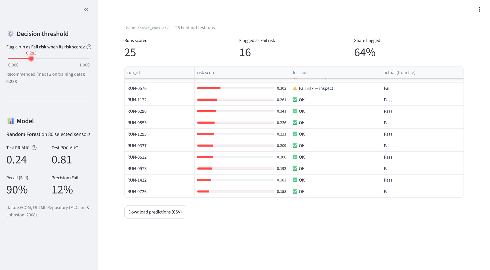

# 🔬 Semiconductor Fail Detection — SECOM

**Flag chip production runs that are likely to fail the line test — before they reach it — and show engineers which of 590 sensors matter.**

**▶ Live app:** [secom-fail-detector.streamlit.app](https://secom-fail-detector.streamlit.app) ·  **Notebook:** [`SECOM_Fail_Detection.ipynb`](SECOM_Fail_Detection.ipynb)



   *Demo with the bundled sample file: 25 held-out test runs, 10 of them real fails. The sample is enriched for the demo — the real fail rate is about 7%, so in production most flagged runs are false alarms (precision 12% on the full test set).*

---

## The problem
A semiconductor fab records **590 sensor signals** for every production run, and about **1 run in 15 fails** the final in-house test. Catching failing runs early saves materials and test time; knowing which signals drive failures tells engineers where to look.

- **Data:** SECOM — 1,567 production runs × 590 anonymised sensors, 104 fails (6.6%), July–October 2008 · [UCI ML Repository](https://archive.ics.uci.edu/dataset/179/secom) (McCann & Johnston, 2008)
- **Target:** Fail (1) vs Pass (0)
- **Main metric:** PR-AUC. Accuracy is misleading here — predicting "always pass" already scores 93%.
- **Operating point:** threshold 0.283, chosen to maximise F2 (recall weighted ×2) on out-of-fold training predictions

## Results — held-out test set (314 runs, 21 fails)

| Metric | Baseline (always "pass") | **Random Forest** |
|---|---|---|
| PR-AUC | 0.067 | **0.240** (95% CI 0.14–0.42) |
| ROC-AUC | 0.500 | **0.813** (95% CI 0.70–0.91) |
| Recall (Fail) | 0% | **90%** (19 of 21 fails caught) |
| Precision (Fail) | – | 12% |
| Runs flagged for inspection | 0% | 50% |

Inspecting the 50% of runs the model flags catches **1.8× more failing runs** than inspecting the same number at random.

**Top sensors:** `sensor_060` (strongest by far), `sensor_206`, `sensor_248`, `sensor_022`, `sensor_122`

### Model comparison — 5-fold CV on the training set (tuned)

| Model | Reduction | CV PR-AUC | CV ROC-AUC |
|---|---|---|---|
| Baseline (prior) | – | 0.066 | 0.500 |
| **Random Forest** | **Feature selection** | **0.223** | **0.710** |
| Logistic Regression | PCA | 0.215 | 0.692 |
| SVM (RBF) | Feature selection | 0.214 | 0.707 |
| SVM (RBF) | PCA | 0.210 | 0.682 |
| Logistic Regression | Feature selection | 0.209 | 0.693 |
| Gradient Boosting | Feature selection | 0.195 | 0.667 |
| Random Forest | PCA | 0.175 | 0.599 |
| Gradient Boosting | PCA | 0.157 | 0.633 |

Feature selection matched or beat PCA for every model and keeps real, explainable sensors. A wider tuning grid (0.245 ± 0.080) and a soft-voting ensemble (0.240 ± 0.079) did not improve beyond the fold-to-fold variability, so the simpler Random Forest was kept.

## Approach
1. **Split first** — stratified 80/20; all EDA, preprocessing, tuning and threshold decisions use the training set only.
2. **Leak-free scikit-learn pipeline** — drop sensors with > 50% missing → clip outliers to training quantiles → median imputation → drop constant sensors → drop near-duplicates (|r| > 0.95) → standardise → select 80 sensors (ANOVA F-test) → Random Forest (200 trees, depth 4, class-balanced). 590 sensors → 273 after cleaning → 80 used by the model.
3. **Feature selection vs PCA** — every model tuned with both (grid search, 5-fold stratified CV, PR-AUC).
4. **Evaluation** — test metrics with bootstrap 95% CIs, error analysis by month, and a time-ordered split to test robustness to process drift.
5. **Explainability** — permutation importance for the top-10 sensors; the app also explains each run individually.

## The app
- Upload a CSV of production runs (or click **Try the sample file**) → fail-risk score and decision for every run
- Adjustable threshold so the quality team can match the number of flags to its inspection capacity
- **"Why this run?"** chart for any run, plus a global top-10 sensors chart
- Clear messages for bad files (wrong columns, text values, empty files) instead of crashing

## Run it locally
```bash
git clone https://github.com/Nada-kh-code/secom-fail-detection.git
cd secom-fail-detection
python -m venv .venv
.venv\Scripts\activate          # Mac/Linux: source .venv/bin/activate
pip install -r requirements.txt
jupyter notebook SECOM_Fail_Detection.ipynb   # Run All: downloads the data and saves the model
streamlit run app.py
```

## Repository
```
├── SECOM_Fail_Detection.ipynb   # full analysis: framing → EDA → pipeline → tuning → evaluation → insight
├── secom_pipeline.py            # custom transformers + upload validation (shared by notebook and app)
├── app.py                       # Streamlit app
├── models/                      # saved pipeline bundle (created by the notebook)
├── sample_data/sample_runs.csv  # 25 held-out test runs for the demo
├── assets/                      # screenshot
└── requirements.txt
```
The dataset is not stored in the repo; the notebook downloads it from UCI.

## Limitations
- Only **104 failures** in total (21 in the test set) → wide uncertainty on every metric.
- **Process drift:** on a time-ordered split (train on the earliest 80%, test on the latest 20%) performance drops to PR-AUC 0.092 (baseline 0.054), ROC-AUC 0.651, recall 0.47 → the model should be retrained regularly and its threshold re-checked.
- Sensor names are anonymised, so findings are associations, not physical causes.
- Data from one factory in 2008; results must be re-validated on any other line or period.

---
*NextGen Institute — Machine Learning final project.*
